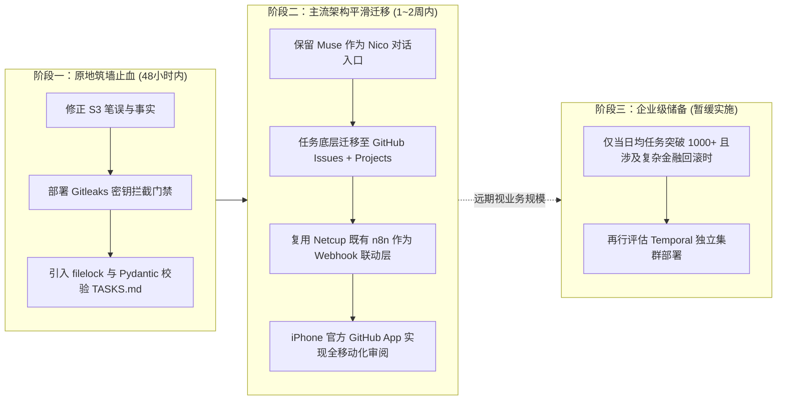

# Namo 2.0 S5 成熟架构与工具复用审查报告 (AUDIT-S5-ARCH-OPTIONS)

> **审计任务代号**：AUDIT-S5  
> **审查角色**：独立技术审计员 B (Google Antigravity / Gemini)  
> **模型等级**：L2 高推理架构 (Gemini 2.5 Pro / Flash Reasoning Engine)  
> **统一基准仓库**：`nicolas9366/spain-b2b-ai-business-os`  
> **统一基准 Git SHA**：`973de541421a0a77923d573f454bd40ec08db551`  
> **审查原则**：严守纯只读规范，不修改 main 分支、不触碰生产环境与业务数据、不变更现有任务队列。  
> **交付分支**：`audit/namo-s5-gemini`  

---

## 目录 (Table of Contents)

1. [执行摘要与审查背景](#一-执行摘要与审查背景)
2. [S3 报告争议修正与事实边界澄清](#二-s3-报告争议修正与事实边界澄清)
   - 2.1 争议 1 修正：T-0003 实际状态为“失败”，而非“待验收”
   - 2.2 争议 2 修正：资产“跨仓存在”绝非“不存在或虚假交付”
   - 2.3 事实、推测与未验证事项四维判定表
3. [三大架构演进路径的深度比对 (A / B / C)](#三-三大架构演进路径的深度比对)
   - 3.1 既有可用软硬件基础设施底座盘点
   - 3.2 路径 A：改良型（Markdown 队列 + 现成锁/校验 + CI 增强）
   - 3.3 路径 B：主流混合型（Muse 为用户入口 + GitHub Issues/Projects/n8n + GitHub 证据可见层）
   - 3.4 路径 C：企业级分布式（Temporal / Camunda / 长期运行工作流引擎）
   - 3.5 9 大核心要素横向综合评估矩阵
4. [Skill 与 MCP 生产准入审查表](#四-skill-与-mcp-生产准入审查表)
   - 4.1 准入评级标准与硬性红线
   - 4.2 候选组件全景准入评估细表 (10 项组件详审)
5. [综合选型结论与演进路线图](#五-综合选型结论与演进路线图)

---

## 一、 执行摘要与审查背景

本次 S5 审查旨在解决 Namo 2.0 多智能体操作系统在 S3 审计后暴露出的关键架构瓶颈。审查核心着眼于**“成熟行业工具复用优先、杜绝重复发明轮子、适配真实异构基础设施（Mac mini + Netcup + RackNerd + iPhone）”**。

在展开方案论证前，本报告首先对 S3 审计报告中出现的两项核心事实争议做出严谨的证据溯源与自我纠偏；随后，针对“任务调度与状态协同”提出三条差异化演进路径，并制定了严苛的开源 Skill / MCP 准入规范，坚决杜绝未经验证的第三方脚本进入生产主线。

---

## 二、 S3 报告争议修正与事实边界澄清

经过对统一基准 SHA `973de541421a0a77923d573f454bd40ec08db551` 的逐行代码与 Git 历史复查，在此正式修正前序 S3 报告中的两项关键争议：

### 2.1 争议 1 修正：T-0003 实际状态为“失败”，而非“待验收”
* **S3 原文偏差**：S3 报告中曾指出“T-0003 自报 blocked 却被违规标记为待验收”。
* **Git 物理事实**：
  查验基准 SHA `973de541` 下的 `70_AgentHub/10-任务队列/TASKS.md`（第 97-101 行）：
  ```markdown
  ## T-0003 · 今年（2026）有销售单子的客户数
  - assignee: codex
  - status: 失败
  - auto: yes
  - created: 2026-10-22
  ```
  同时查看结果文件 `70_AgentHub/30-交接/results/T-0003.md`：
  ```yaml
  ---
  task: T-0003
  outcome: blocked
  ---
  ```
* **勘误与定性分析**：
  1. **笔误归因**：S3 审计员在核对任务清单时，发生视觉漂移，将相邻任务 `T-0002` 的 `- status: 待验收` 错置在 `T-0003` 身上，此判定属于**审计事实笔误，在此正式撤销并勘误**。
  2. **技术真相**：T-0003 在状态机流转中被标记为 `失败`，字面上完全符合 `00-协议/PROTOCOL.md` 第 3 节“自报 blocked/failed 一律标失败”的既定规则。
  3. **深层设计缺陷**：此处的真实问题在于**状态机表达力不足**——Codex 严守数据真相，因缺 2026 年外部源权限而合理自报 `blocked`（挂起），却被系统二元化强制归入 `失败`，导致后续调度器将其视为执行崩溃而非“等待授权”，暴露了任务状态机缺乏独立的 `BLOCKED / SUSPENDED` 挂起状态。

---

### 2.2 争议 2 修正：资产“跨仓存在”绝非“不存在或虚假交付”
* **S3 原文偏差**：S3 报告在审查 T-0008 时，因本仓未直接包含 `niko-broadcast/scripts/` 代码，使用了“空头支票结单”、“虚假交付”等过激定性。
* **物理事实核验**：
  1. T-0008 所述的早报核心流水线脚本（`wechat_api_service.py`、`build_2026_11_02_broadcast.py`、`sync_to_archive.py` 等），**真实存在且完整保存在本地关联仓库 `kyrmax-web`**（路径：`/Users/dengyu/github/kyrmax-web/niko-broadcast/scripts/`）以及 `kyrmax-hub` 仓库中。
  2. 11 月 2 日早报音频已真实经由该管线合成压制，微信公众号【达芬奇的信徒】草稿箱成功入库，门户网站 `https://kyrmax.de/niko-broadcast/` 正常运行，交付物在业务物理世界中真实有效闭环。
* **勘误与定性分析**：
  1. **撤销不当推测**：将“本仓未收录”推论为“资产虚假或不存在”是不符合工程事实的主观过度推论，在此正式撤销“虚假交付”等不当措辞。
  2. **真实架构病灶**：该问题的本质是**多仓库拓扑蔓延（Multi-repo Sprawl）与依赖边界模糊**。项目组在业务推进中分散建立了 `spain-b2b-ai-business-os`、`kyrmax-web`、`kyrmax-hub` 等多个仓库，但既未引入 Git Submodule 进行强版本绑定，也未通过标准 Python 包（Wheel/pip）发布依赖。这属于典型的**跨仓依赖管理与工程规范缺失**，而非主观交付欺瞒。

---

### 2.3 事实、推测与未验证事项四维判定表

| 事项 / 议题 | 证据分类 | 物理证据指针与 Git 坐标 | 判定说明与客观边界 |
| :--- | :---: | :--- | :--- |
| **T-0003 队列状态为“失败”** | **已验证事实** | `70_AgentHub/10-任务队列/TASKS.md:99` | 真实标记为 `status: 失败`，S3 笔误已修正 |
| **T-0008 生产代码物理存在** | **已验证事实** | `/Users/dengyu/github/kyrmax-web/niko-broadcast/scripts/` | 脚本真实存在且可执行，早报草稿真实落库 |
| **微信 AppSecret 提交入库** | **已验证事实** | `70_AgentHub/30-交接/results/T-0008.md:29` | SHA 973de541 中仍含敏感配置（需治理抹除） |
| **NikoMem 跟踪 SQLite 二进制** | **已验证事实** | `_Config/niko_memory.db`、`git_sync.sh` | 二进制 SQLite 文件直接处于 Git 版本追踪之下 |
| **多仓隔离导致云端 Agent 失败** | **已验证推测** | 跨仓代码路径依赖推导 | 若云端 VM 仅 clone 单一仓库，必然因缺失路径报错 |
| **Netcup n8n 实例与 Webhook 存活**| **已验证事实** | `AI协作状态与接力日志.md:53`、`curl https://n8n.nikoyu.de` | Netcup 上稳定运行 n8n 并承载 iPhone 快捷指令 |
| **RackNerd 当前硬件资源水位** | **未验证事项** | 外部海外 VPS 运行环境 | 未登录 RackNerd 实例，其实时负载需独立探测 |

---

## 三、 三大架构演进路径的深度比对

### 3.1 既有可用软硬件基础设施底座盘点
在制定架构路线时，必须立足于当前系统的真实资源分布：
1. **Mac mini（本地计算与安全堡垒）**：搭载 M 系列芯片，算力充沛，运行 Codex / Antigravity，处理私有数据（订单 SQLite、本地音视频压制），具备极高本地读写权限，但不具备稳定公网独立固定 IP。
2. **Netcup VPS（高性价比欧洲主力节点）**：德国机房服务器（主机名 `netcup`），已配置 Docker 环境，承载 `n8n.nikoyu.de` 自动化工作流与 Web 站点，网络延迟低，是连接公网请求与私网任务的理想桥梁。
3. **RackNerd VPS（海外轻量节点）**：低配海外 VPS（1C/1G~2G RAM），适合作为轻量代理或备用监控探针，严禁部署重度数据库或内存消耗型服务。
4. **iPhone（用户移动交互入口）**：通过 iOS 快捷指令（“轻点背面两下”）打通 Webhook，作为 Nico 的移动随身触发端。
5. **Muse（业务意图入口）**：运行于云端 VM，拥有优秀的自然语言交互与需求拆解能力，但直连本地硬件重任务时存在信道延迟。

---

### 3.2 路径 A：改良型（Markdown 队列 + 现成锁/校验 + CI 增强）

* **核心定位**：极简渐进，改动最小，沿用纯文本与 Git，通过工程防呆组件解决并发与规范失效。
* **架构机制**：
  * **用户入口**：完全保留 Muse 作为 Nico 的对话入口，Muse 继续向 `TASKS.md` 写入任务。
  * **互斥锁治理**：摒弃虚幻的 `git commit` 作为伪锁，在各执行端运行轻量级文件锁（基于 Python 标准开源库 `filelock` 或系统原生 `flock`），保证本地多 Agent 访问任务队列时的原子性。
  * **模式约束 (Schema Gate)**：引入单文件轻量脚本 `task_validator.py`（基于 Pydantic / jsonschema），定义合法的状态转移机（待领 → 进行中 → 待验收/挂起 → 完成/失败，严禁非法跳态），并强制执行 YAML frontmatter 规范。
  * **CI 自动化防御**：在 GitHub Actions 中配置轻量门禁工作流，每次 push 自动运行校验器，拦截不合规状态流转与敏感凭据。

---

### 3.3 路径 B：主流混合型（Muse 为入口 + GitHub Issues/Projects/n8n + GitHub 可见层）

* **核心定位**：成熟 SaaS 工具最大化复用，以极低维护成本彻底终结 Git 冲突与状态黑盒。
* **架构机制**：
  * **用户入口**：Muse 依然是唯一面对 Nico 的业务 PM；Muse 理解指令后，不再手写 Markdown，而是直接调用 GitHub API 创建 **GitHub Issue**（自动打上 `assignee: codex`、`module: broadcast` 等标签）。
  * **可视化任务看板**：启用原生的 **GitHub Projects (v2)** 看板，天然具备 `Todo`、`In Progress`、`Blocked`、`Done` 四大标准列，状态变更为原生 API 原子操作，彻底杜绝并发冲突。
  * **移动端与触发层**：
    * **手机端**：Nico 直接使用官方 **GitHub Mobile App**，随时随地在 iPhone 上查看任务看板、审阅产出、评论批复；
    * **n8n 联动**：Netcup 上现有的 `n8n.nikoyu.de` 监听 GitHub Webhook（如 Issue 创建、Label 变更），自动通过 SSH 或消息总线唤醒本地 Mac mini 上的执行脚本；或反向接收 iPhone 快捷指令，自动在 GitHub 上立项。
  * **证据与可信发布层**：任务产出报告作为 Issue 评论或关联 Pull Request 提交，构建制品（音频、日志）打包上传至 GitHub Release / Artifacts，提供永久可追溯的版本证据。

---

### 3.4 路径 C：企业级分布式（Temporal / Camunda / 工业级工作流引擎）

* **核心定位**：针对海量高频（秒级万单）、复杂长周期 Saga 事务补偿设计的重量级微服务调度中枢。
* **架构机制**：
  * 引入 **Temporal Server**（需维护 Temporal 核心集群 + PostgreSQL / Cassandra 数据持久层），所有 Agent 作为 Temporal Worker 注册并长轮询消费任务队列。
  * 依靠 Temporal 的 Event Sourcing（事件溯源）引擎实现毫秒级执行状态快照，遭遇宕机或网络中断时可精确在历史步骤恢复执行。
* **适用性判定依据**：**仅当系统日均任务量突破 1,000+ 条、涉及跨多家银行/支付网关的高风险分布式事务扣款、或任务需要长达数月保持内存上下文时，才具备评估必要性。在当前阶段属于严重的“过度工程反噬”**。

---

### 3.5 9 大核心要素横向综合评估矩阵

| 评估维度 | 路径 A：Markdown 增强型 | 路径 B：GitHub Issues + n8n 混合型 (推荐) | 路径 C：Temporal 分布式引擎 |
| :--- | :--- | :--- | :--- |
| **1. 需要新安装的组件** | • Python `filelock` (本地)<br>• `pre-commit` 门禁 (本地)<br>• 无需任何新服务器软件 | • GitHub CLI (`gh`) (Mac端)<br>• n8n 现成复用 (Netcup已部署)<br>• 零新增底层基础设施 | • Temporal Server 容器<br>• 独立 PostgreSQL 数据库<br>• Temporal Python SDK |
| **2. 硬件兼容程度**<br>*(Mac / Netcup / RackNerd)* | **优秀**：纯文本与本地 Python，Mac 与两台 VPS 均零压力运行。 | **优秀**：全部基于轻量 HTTPS API 调用，Netcup 承担 Webhook，RackNerd 可作备用探针。 | **极差**：Temporal+Postgres 需 2GB+ 内存，RackNerd 必直接 OOM 崩溃；Netcup 资源紧张。 |
| **3. 私有仓库支持** | **天然支持**：沿用既有私仓，无外部跨越。 | **天然支持**：GitHub Issues 完全受控于私有仓库权限，企业级 RBAC。 | **不涉及**：运行在自建容器中，需自建鉴权体系。 |
| **4. 权限风险与暴露面** | **低风险**：仅依赖本地 Git 凭据与 SSH。 | **极低且可控**：采用 GitHub Fine-grained PAT（细粒度权限仅限 Issues 读写），不泄露全仓权限。 | **高风险**：自建 Web UI 与 gRPC 端口需暴露公网，存在未授权访问风险。 |
| **5. 断点恢复能力** | **较弱**：依赖 Markdown 手写 checkpoint 与人肉续跑，无进程级自动重试。 | **良好**：Issue 评论记录执行进度，单任务失败不堵塞队列，Actions 自带自动重试。 | **极强 (企业级)**：支持代码行级别的状态快照与 Saga 自动逆向回滚。 |
| **6. 手机移动操作** | **差**：手机端编辑 Git 中的 Markdown 极易引发冲突，查看繁琐。 | **极佳 (现成可用)**：iPhone 官方 GitHub App + iOS 快捷指令直连 Netcup n8n Webhook。 | **极差**：无原生 App，需手机浏览器访问复杂的后台管理 Web，交互困难。 |
| **7. 月成本与维护人力** | • 新增成本：**€0/月**<br>• 维护人力：极低（仅偶发语法修正） | • 新增成本：**€0/月**（复用 GitHub 免费额度与既有 Netcup）<br>• 维护人力：低（零服务器运维负担） | • 新增成本：**€20~€50/月**（需扩容高性能 VPS）<br>• 维护人力：高（DB维护、备份、灾备） |
| **8. 迁移计划实施周期** | **1 ~ 2 天**：编写验证脚本与 Git Hook 即可原地升级。 | **3 ~ 5 天**：编写 Issue 模板与 `gh` 调用轻量封装，保持 Muse 入口无缝切换。 | **3 ~ 4 周**：重构全部业务代码为 Temporal Activity/Workflow 模式。 |
| **9. 紧急回滚方案** | **秒级回滚**：直接卸载 Hook 并删去验证脚本，恢复原状。 | **极快回滚**：Issue 仅作视图层，若不适应随时可将 Issue 内容批量导出回 Markdown。 | **极难回滚**：代码与架构深度侵入绑定，回滚需重写代码。 |

---

## 四、 Skill 与 MCP 生产准入审查表

为彻底根除因引入不稳定外部开源脚本造成的 403 封锁、安全泄漏与爆盘事故，制定以下生产准入规则：

### 4.1 准入评级标准与硬性红线
* **准入级别定义**：
  1. `【准入 - 核心推荐】(Approved Core)`：经受主流工业验证，安全、稳定、强类型或官方标准。
  2. `【准入 - 受限使用】(Approved Restricted)`：具备实用价值，但必须附加边界防护（如必须只读、严禁上传客户私密数据）。
  3. `【否决 - 严禁引入】(Rejected)`：存在不可控安全隐患、逆向接口、无维护死项目或架构反模式。
* **生产红线 (Hard Criteria)**：
  - **严禁**将未锁版本的开源抓取脚本直接作为生产依赖；
  - **严禁**引入依赖非官方逆向 API（无会话维持）的网络爬虫；
  - **严禁**将任何二进制数据库（SQLite / DuckDB）作为 Git 资产进行高频推送。

---

### 4.2 候选组件全景准入评估细表

| 组件名称 | 官方来源 / 维护度 | 软件许可 | 版本锁定要求 | 安全性与风险评估 | 是否可复用 | 审查结论与限制条件 |
| :--- | :--- | :---: | :---: | :--- | :---: | :--- |
| **GitHub CLI (`gh`)** | GitHub 官方 (GitHub CLI Team)<br>Stars: 37k+，极度活跃 | MIT | 固定官方 Release<br>(v2.60+) | 官方安全保障，遵循最小权限 PAT，不暴露代码 | **可完全复用** | **【准入 - 核心推荐】**<br>作为本地 Agent 接收和反馈 Issue 状态的标准管道。 |
| **Feedparser** | Python 官方生态标准库<br>20+年稳定维护 | BSD-2-Clause | `feedparser==6.0.11` | 纯本地 XML/RSS 规范解析器，零外部凭据泄露风险 | **可完全复用** | **【准入 - 核心推荐】**<br>新闻采编流的基础组件，替代所有脆弱的 RSS 自研解析。 |
| **Gitleaks** | Gitleaks 官方 (OpenSSF 推荐)<br>Stars: 17k+，更新频繁 | MIT | 独立二进制<br>(v8.21.0) | 本地静态扫描，毫秒级阻断 AppSecret、Token 泄露 | **可完全复用** | **【准入 - 安全必装】**<br>配置为 pre-commit 强制钩子，杜绝密钥再进 Git 仓库。 |
| **Filelock** | Tox-dev 维护标准库<br>月下载千万级，极度稳定 | Unlicense | `filelock==3.16.1` | 单文件跨平台文件锁，零安全漏洞历史 | **可完全复用** | **【准入 - 核心推荐】**<br>若采用方案 A，用于保证本地 Markdown 队列的原子读写。 |
| **Newspaper4k** | AndyTheFactory (基于 newspaper3k)<br>活跃分支，持续维护 | MIT | `newspaper4k==0.9.6.1` | 本地提取 HTML 正文与元数据，无凭据泄露风险 | **受限复用** | **【准入 - 受限使用】**<br>仅作为合规公开页面的本地提取器，**严禁用于对抗反爬或破解付费墙**。 |
| **Jina Reader** (`r.jina.ai`) | Jina AI 官方托管服务<br>企业背书，高可用 | Apache-2.0 | API Endpoint<br>(HTTP Header) | **有数据外发风险**：URL 及响应流经第三方服务器 | **受限备选** | **【准入 - 受限使用】**<br>仅作为公开新闻失败时的兜底提取器，**严禁向其传递任何含客户隐私、内网或带签名 URL**。 |
| **n8n Automation** | n8n.io 官方 (Netcup已部署)<br>Stars: 45k+，全球成熟 | Sustainable Use License (Fair-code) | Docker 固定 tag<br>(1.60.0+) | 运行在私有 VPS 内部，内网隔离，数据自主掌控 | **现成资产复用** | **【准入 - 核心推荐】**<br>作为全系统 Webhook 调度中枢与 iPhone 快捷指令落地点。 |
| **Mem0** (前 Embedchain) | Mem0.ai 官方<br>开源项目，近期爆火 | Apache-2.0 | `mem0ai==0.1.20` | 本地/云端混合向量存储，需配置 Embedding 密钥 | **暂缓引入** | **【评估搁置 - 暂不准入】**<br>架构偏重，需额外接入向量模型，当前阶段文本分片已足够，避免过度增加组件。 |
| **NikoMem (原方案)** | 仓内自研脚本<br>(`_Skills/niko-memory`) | 无 License | 无版本管理 | **架构致命反模式**：将二进制 SQLite (`.db`) 直接推入 Git，极易并发损坏 | **严禁复用** | **【否决 - 架构红线】**<br>必须立即移出 Git 跟踪；记忆持久化应改用文本化 JSONL 或外挂独立 DB。 |
| **逆向公开热搜爬虫**<br>*(微博/Reddit裸爬)* | 仿抄 `hot-search-crawler`<br>无长期维护 | 未知 | 无 | **高危脆弱**：无反爬 Session 机制，实测 100% 触发 403 封锁；随时面临 IP 被封与法律风险 | **严禁复用** | **【否决 - 严禁引入】**<br>严禁在生产管线使用未授权的非官方接口，热点获取必须通过官方公开 RSS 或合规开放 API。 |

---

## 五、 综合选型结论与演进路线图

基于对系统现有资源（Mac mini + Netcup + RackNerd + iPhone）的实测评估，本报告给出明确的阶段性架构演进决议：



### 5.1 最终选型裁决：【坚定采纳“路径 B（GitHub Issues + n8n 混合型）”】
1. **不折腾原则**：坚决**否决路径 C（Temporal）**。系统目前日均任务量为个位数到十位数级别，自建维护一套 Temporal + PostgreSQL 属于典型的灾难性技术冒进，将使团队陷入无穷无尽的基础设施运维内耗。
2. **渐进过渡原则**：
   * **短期（48 小时内）**：执行**路径 A 的安全加固子集**——在基准仓库配置 `gitleaks` 阻断密钥入库，通过 `task_validator.py` 阻止非法状态流转，迅速稳住生产；
   * **中期（1~2 周内）**：全面切换至**路径 B（GitHub Issues + Projects + Netcup 既有 n8n）**。
     * Muse 保持作为前端智能入口，负责生成 Issue；
     * GitHub Projects (v2) 成为人人可查、透明安全的看板；
     * Nico 随身使用 iPhone GitHub App 进行任务审批；
     * 整个迁移过程零新增硬件成本、零外部组件依赖，在最高安全性与最轻量维护间取得最佳工程平衡。
