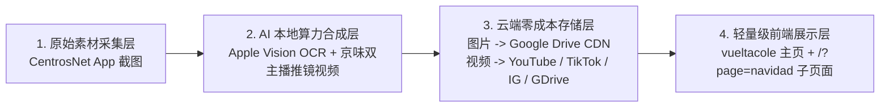

# Main Paper · Vueltacole 全域营销与云端零膨胀媒体标准操作手册 (SOP 模型 v2.0)

> **核心理念**：网站代码仓库 (`vueltacole`) 只存轻量级结构化数据 (`JSON/TS`) 与交互组件，**严禁将高分辨率产品照片库或数十兆的 MP4 视频直接塞进网站服务器或 Git 仓库**。

---

## 一、 架构总览：四层分离 SOP 模型 (4-Tier Decoupled SOP)

### 1. 视觉与交互设计规范 (`REBUILD_SOP.md` & `GEMINI.md`)
- **色彩体系**：20 周年红金 (`#E52521` / `#DC2626`、流光金 `#F8D878` / `#FBBF24`、深石板蓝 `#0F172A`) + 圣诞祖母绿 (`#14532D`)。
- **组件风格**：马里奥/大富翁块状立体阴影 (`border-4 border-[#222] shadow-[6px_6px_0px_#222]`) + `Fredoka` 游戏感圆体字。
- **数据驱动双语 (`CONFIG_I18N`)**：严禁硬编码文案，所有字段统一在 `src/data/christmas2026DB.ts` 的 `CONFIG_I18N` 字典中维护，支持 `[中文 | ES]` 一键切换。
- **B2B ROI 算账模型**：主页内置实时 ROI 测算器（例如 `€2,000` 进货额 → 叠加返利与磁吸日历/20周年日历赠品 → 裂变 `€3,100+` 终端总价值）。

---

## 二、 媒体云端分流规范 (Zero-Website-Bloat Cloud Media SOP)

### 1. 产品照片：自动同步 Google Drive 云盘并提取直链 ID
- **本地挂载路径**：`~/Library/CloudStorage/GoogleDrive-mr.dengyu@gmail.com/我的云端硬盘/MainPaper_Cloud_Assets/<活动目录>/`
- **自动化机制**：
  1. 将原图裁切（**不作去水印涂抹，100% 保留原始锐度**）后存入上述 Google Drive 目录；
  2. macOS Google Drive 客户端自动后台上传，并在文件扩展属性 `com.google.drivefs.item-id#S` 中写入云端 `FILE_ID`；
  3. 运行 `python3 scripts/cloud_media_sync.py` 即可自动读取所有图片的 `FILE_ID`，生成免鉴权高速外链：
     - 主 CDN 直链：`https://lh3.googleusercontent.com/d/<FILE_ID>=w1200`
     - 备用缩略图链：`https://drive.google.com/thumbnail?id=<FILE_ID>&sz=w1200`

### 2. 导购视频：京味男女双主播 + 随语音三段式推镜 + 社媒云端分发
- **配音标准**：统一采用京味男声 (`zh-CN-YunjianNeural`, `-8Hz`) 与京味女声 (`zh-CN-XiaoxiaoNeural`, `+2Hz`) 对口导购。
- **手机端微距推镜 (`1.0x → 1.8x → 2.0x`)**：
  - 阶段 1 (`0%–20%`)：`1.0x` 原图全景展示；
  - 阶段 2 (`20%–55%`)：`1.8x` 放大左侧展示盒规格与中间核心单品；
  - 阶段 3 (`55%–95%`)：`1.9x–2.0x` 平移特写右侧微距实拍与配件细节，同时左下角显示**画中画 (PiP) 红框雷达定位**。
- **视频云端托管渠道**：
  - **Google Drive 云端流媒体（即时生效）**：自动同步至 `MainPaper_Cloud_Assets/Navidad_2026/`，通过 `https://drive.google.com/file/d/<VIDEO_ID>/preview` 嵌入网页；
  - **YouTube Shorts / TikTok / Instagram Reels**：发布至官方社媒账号后，将对应 Video ID 填入 `CLOUD_MEDIA_CONFIG.videoChannels`，网页即可一键切换四大云端播放器。

---

## 三、 当前已上线的 2026 圣诞与日历大促云端资产清单

- **Google Drive 云端文件夹 ID**：`198GTrTbINQmfsb1MKaXFuW7v2YrfbPnN`
- **21 款全景高清长图海报 ID**：`1YwUrp5QaG_VQQcZKaYZhUzvbRGD2vQvW`
- **18 组 SKU 完整版京味导购视频 ID**：`1lni1UweWy6NJ2cwFVwIgEN4YlLPMB1RC`
- **子页面访问路由**：
  - 主页：`/?page=home`
  - 2026 圣诞与日历大促子页面：`/?page=navidad#/navidad`
  - 返校季学校与门店地图：`/?page=map#/map`
  - 金票扫码核销台：`/?canje=CP-SMN3BYY1HKUN`
